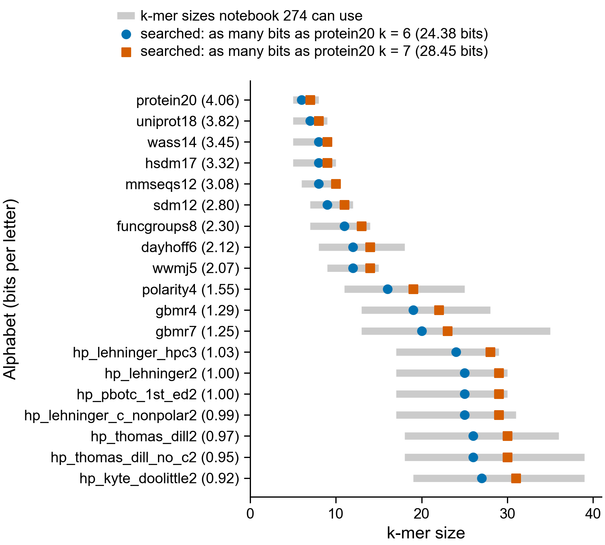
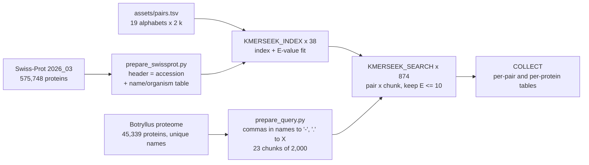
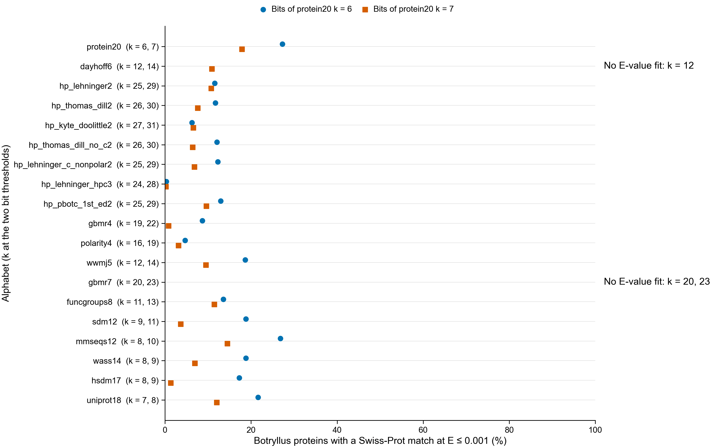

# kmerseek: the Botryllus proteome against Swiss-Prot, 19 alphabets at two k-mer sizes



**The k-mer size searched for each alphabet.** Each row is one of kmerseek's 19 reduced
amino-acid alphabets, with its bits per letter in brackets. Blue circles: the smallest k
whose k-mers carry as many bits as a protein20 (all 20 amino acids) 6-mer, 24.38 bits.
Orange squares: the same for a protein20 7-mer, 28.45 bits. Grey bars: the k-mer sizes
that notebook 274 of seanome/2024-kmerseek-analysis gives each alphabet (from about 100
human proteins sharing a k-mer by chance, up to one chance match in all of Swiss-Prot).
All 38 k-mer sizes fall inside their alphabet's bar.

## What it does

The whole Botryllus proteome (45,339 proteins) is searched against UniProtKB/Swiss-Prot
release 2026_03 (575,748 reviewed proteins) with kmerseek v0.4.0, once for each of 38
alphabet-ksize pairs (`assets/pairs.tsv`).



### How the k-mer sizes were chosen

The rule is notebook 235's (`notebooks/235_plan_arms.py` on branch
`nb232-kmerseek-botryllus-human-immune-hits`), which follows notebook 274 of
seanome/2024-kmerseek-analysis. Bits per letter is −log2 of the chance that two Swiss-Prot
residues drawn at random fall in the same letter class, using the Swiss-Prot 2026_03
amino-acid composition. For each alphabet, k is the smallest k whose k-mer carries at
least the bits of a protein20 k-mer at k = 6 (24.38 bits) or k = 7 (28.45 bits). The k = 7
column is the same as notebook 235's `235_arms.tsv`. `bin/plan_pairs.py` writes the table.

### Settings

Each pair's mismatch penalty and X-drop for extending a match are notebook 233's
(notebook 241's plan). The search keeps a protein pair when the whole-query p-value is
below 0.05 or its best region scores at least 1.3, as in notebooks 232 to 235.
Low-complexity k-mers (homopolymer runs) are removed from the index.

* **Pairs with an E-value fit:** the index stores a Karlin-Altschul fit made on 200
  Swiss-Prot sequences, refitted on 1,000 when the first is refused. Matches with
  E ≤ 10 are kept.
* **Pairs without a fit** (if any): searched without extension, so E is not defined.
  Matches are kept only when their region p-value is below 0.05 / (45,339 × 575,748) =
  1.9 × 10⁻¹². The summary tables mark these pairs `unfitted`.

### Inputs

* Query: `botryllus_new_genome_protein_unique_names.fasta` (md5 `414f4a93…`), the proteome
  in which every protein has its own name (shared names carry .1, .2; map in
  `nextflow_runs/timing-pilot/botryllus_renamed_proteins.tsv` on branch
  `olgabot/annotation-timing-pilot`). The original FASTA repeats 2,019 names;
  `prepare_query.py` stops if given it. Ten names with a comma get '-' instead and one '.'
  inside a sequence becomes X (`results/query/query_renaming.tsv`).
* Target: `uniprot_sprot.fasta.gz`, release 2026_03 of 02-Sep-2026.

### Outputs

On Sherlock under `$SCRATCH/botryllus-kmerseek-swissprot/results/`:

* `matches/<alphabet>.k<k>/chunk_NNNN.<alphabet>.k<k>.matches.csv.zst`: every kept match,
  all kmerseek columns. `target_name` is the Swiss-Prot accession.
* `summary/kmerseek_botryllus_swissprot.pairs.tsv`: per pair, fitted or not, and how many
  Botryllus proteins have a kept match and a match at E ≤ 0.001.
* `summary/kmerseek_botryllus_swissprot.per_protein.tsv.gz`: per Botryllus protein, the
  number of fitted pairs where it has a match at E ≤ 0.001, and its best match over all
  fitted pairs with the Swiss-Prot name and organism.
* `summary/kmerseek_botryllus_swissprot.best_per_protein_per_pair.tsv.gz`: the best match
  of every protein in every pair.

`make pull` copies `summary/`, `query/` and the trace into `results/` here.

## Resources, predicted from measured runs

Every first ask comes from the 0.4 dark-set run of seanome/2024-kmerseek-analysis
(`runs/ladder-0.4-midi`), which searched the same 45,339 Botryllus proteins, in 23 chunks
of 2,000, against Swiss-Prot minus the 120 Ascidiacea entries, at every one of these
alphabets and most of these k-mer sizes, with the same kmerseek version. That run kept
low-complexity k-mers and kept matches up to E = 10,000, so it needed more memory and
wrote far more than this one will.

| Step | Tasks | Measured before | First ask |
|---|---|---|---|
| Swiss-Prot index + fit | 38 | build without fit: ≤ 10 min, ≤ 79 GB (25 of these 38 pairs, index trace collection) | 8 CPUs, 128 GB, 6 h |
| Search, one chunk | 874 | 26 of 38 pairs at this k: longest chunk 19.7 min, peak 6.6-71.3 GB | 4 CPUs, 32-112 GB per pair (`assets/search_resources.tsv`), 2 h |
| Collect | 1 | — (reads 874 small tables) | 16 GB, 2 h |
| Head job | 1 | — | 2 CPUs, 8 GB, 2 days |

Search memory per pair is 1.25 × the largest chunk peak measured at that k. For the 12
pairs not measured at their own k, the peak comes from the nearest measured k of the same
alphabet: a smaller k needs more memory, so its peak is used as it is; a larger k gets
× 1.3 per step down, or × 2 from the k = 7 pair to the k = 6 pair (the measured k = 6 / k = 7
peaks differ by 1.5-1.9×). The `basis` column says which rule each row used. A task killed
by the scheduler is retried once with twice the memory and time.

Time to the first result: indexes about 1 h once running, then each pair's 23 chunks in
about 20 min. The whole run is predicted at under a day of wall time if the hns and normal
partitions give 100-200 tasks at once.

## Running it

```bash
make sherlock-sync          # laptop
ssh sherlock
cd $SCRATCH/botryllus-mhc-kmerseek-swissprot/nextflow_runs/kmerseek-botryllus-swissprot
make sherlock-inputs        # login node: copy and check the two FASTA files
make sherlock-stub          # SLURM: the workflow wiring with no kmerseek
make sherlock-run           # SLURM head job
make sherlock-status        # one look; at least 60 s between looks
```

## Completed original run and added floor-rounded comparison

The original 38-pair run completed on 30 October: 874 successful search tasks,
including 87 reused tasks. All pair counts were checked against the per-query
summary rows, with 45,339 distinct query proteins. The summary tables are in
`results/summary/` and the trace is `results/trace.txt`.



Each point gives the fraction of 45,339 proteins with a match at E ≤ 0.001.
Blue circles use the protein20 k6 bit threshold; orange squares use k7.
Three pairs lack an E-value fit and are marked unavailable. More matches alone
do not establish more accurate annotations.

The additional hp_lehninger2 k24/k27 comparison uses floor rounding, as requested
on 31 October. Its pair table, resource estimates and separate output paths are
recorded in [floor_lehninger.md](floor_lehninger.md). Results remain pending.
