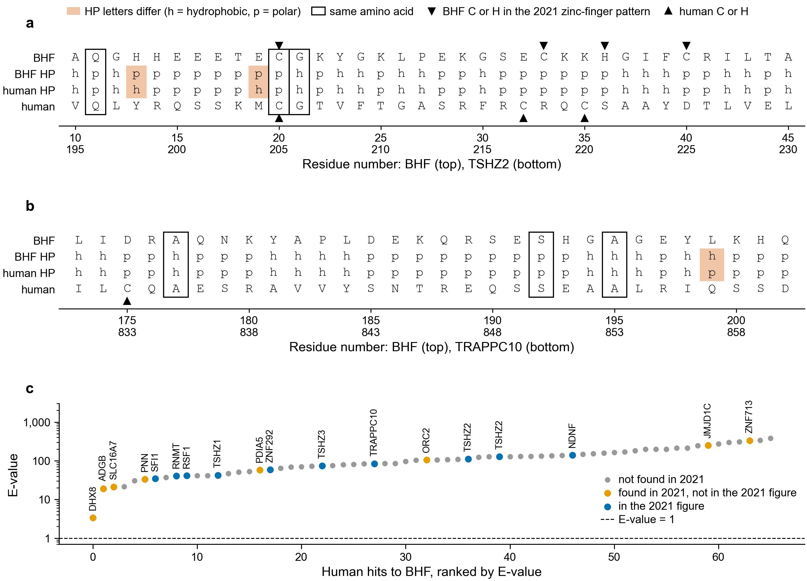

# BHF vs human: the 2021 hits under kmerseek 0.4.0

**a.** BHF residues 10-45 (the 2021 "zinc finger") against TSHZ2 residues 195-230. **b.** BHF
residues 173-202 (the 2021 "membrane tether" match) against TRAPPC10 residues 831-860. The
rows are the BHF residue, its HP letter, the human HP letter and the human residue. HP is
Lehninger's split, the same one sourmash used in 2021 (h = A F G I L M P V W Y, p = C D E H
K N Q R S T). **c.** E-value of all 66 human hits to BHF (kmerseek 0.4.0, Lehninger HP, k = 24,
every k-mer indexed, low-complexity k-mers kept), coloured by what the 2021 sourmash run
found: blue, drawn in the 2021 BHF figure; orange, in the 2021 search or gather results
(notebook 005) but not drawn; grey, not found in 2021. The E-value is the number of hits
this good expected by chance in the whole search; below 1 is the usual cut-off.

## What changed since 2021

kmerseek 0.4.0 finds the same matches at the same positions. The 2021 run had no
significance test: sourmash ranked proteins by shared k-mers and every match was drawn.
kmerseek 0.4.0 gives each match an E-value. With low-complexity k-mers kept, every BHF hit
has E > 1. The best is DHX8 at 3.4. TSHZ1 is at 42, TSHZ3 at 74, TRAPPC10 at 84 and TSHZ2
at 110-127. With low-complexity k-mers removed, one hit passes: DHX8 at E = 0.50, matched
over BHF 49-113, the lysine-rich stretch the 2021 figure matched to RNMT.

Of the 22 genes the 2021 run found, 17 are among kmerseek's 62 genes (66 hits), and 8 of
kmerseek's 13 best hits are 2021 genes. The 5 with no kmerseek hit are CCDC96, HMGB3,
IFT122, MYRFL and TNPO2. kmerseek ranks the matches much as sourmash did; what changed is
that it now says how likely they are by chance.

The E-value here is m × n × 2^-bits, with m = 229 (BHF length minus k plus 1) and n =
11.8 million human residues. That makes 2.7 billion places to start a match, so a match
needs about 31 bits before E drops below 1. One HP letter carries at most 1 bit, so an
exact HP match of 26 letters (three overlapping 24-mers, as for TRAPPC10) is worth about 25
bits. That is about the length of match two unrelated proteins share by chance in a search
this size.

The Poisson p-values in the same rows are very small (TRAPPC10 region: 8 × 10^-12). The
Poisson test counts the three overlapping 24-mers as three independent events. They are
one 26-letter match, so it multiplies the same chance event in three times. The E-value
scores the match once.

Masking low-complexity k-mers (the `lcremoved` arms in the table) lowers the E-values by
about half (TSHZ1 18, TRAPPC10 48). None comes near 1.

The 2026 pipeline in `nextflow_runs/kmerseek-botryllus-human/` uses other HP splits
(`hp-pbotc-1st-ed` k = 19, and `hp-thomas-dill` k = 26 as the script default). Thomas-Dill
puts C with the hydrophobic residues and G and P with the polar ones. That rewrites the HP
letters of the C- and G-rich BHF residues 20-45, so those runs share different k-mers
with human proteins. To compare with 2021, use `hp_lehninger2`.

## The residues

- **Zinc finger (a).** 34 of 36 HP letters agree, but only 3 of 36 amino acids are the
  same. Only one of the four BHF C/H residues of the 2021 C-x12-C-x2-H-x3-C pattern (C20)
  lines up with a human C. TSHZ2's own cysteines here (C217, C220) line up with BHF E32
  and K35. The match is a shared pattern of hydrophobic and polar residues, not a shared
  zinc-binding site.
- **TRAPPC10 (b).** 29 of 30 HP letters agree; 3 of 30 amino acids are the same.

## Has kmerseek changed since this run?

These results come from kmerseek release-0.4.0 (commit 0aed5ca, 2026-09-21). Between then
and 2026-10-24, 16 merged PRs changed kmerseek's source. None has been run on BHF yet.
Sorted by what each can do to the numbers above:

| PRs | What they change | Effect on these BHF hits |
|---|---|---|
| 110, 111 | How the E-value fit reads its chance curve | None. Measured on 2026-09-22: all 66 E-values the same, bit for bit (`~/data/botryllus/kmerseek-isolate/BHF_commit_by_commit.png`) |
| 56, 57, 76, 96, 97, 132 | Ambiguous residues (B, J, Z) | None. BHF and all 62 human proteins it hits have none |
| 93, 158, 65, 77 | Output order, speed, an extra column, code layout | None |
| 136 | Chance count of shared k-mers scaled by the target's length | Changes the Poisson p-values, not the E-values |
| 67, 75 | Extension and E-value code rewritten on main (`evalue.rs`) | Unknown. Same formula, E = K m n e^(-lambda S), but the fit was rewritten. Needs a rerun |

One change was tested on BHF but never merged: lambda fitted per region (commit 982a055).
It moved E-values a lot (SFI1 34 to 3.3, TSHZ2 110 to 14, DHX8 3.4 to no E-value at all),
but none went below 1.

Table: [`232_bhf_zinc_finger_trappc10_kmerseek_v040.csv`](232_bhf_zinc_finger_trappc10_kmerseek_v040.csv).
Script: [`notebooks/232_bhf_2021_vs_kmerseek_0.4.py`](../notebooks/232_bhf_2021_vs_kmerseek_0.4.py).
Input: `~/data/botryllus/kmerseek-0.4/BHF.all_8_arms.kmerseek-0.4.0.hp_lehninger2.k24.csv`.
